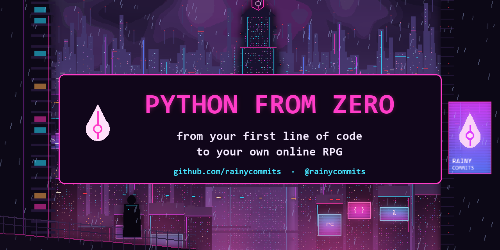

# Python from Zero — through games 🌧️

[](https://github.com/rainycommits/python-from-zero/actions/workflows/lessons.yml)
[](https://www.youtube.com/@rainycommits)
[](LICENSE)



Learn Python from your very first line of code to **your own small online RPG**, one lesson at a time.
No talking, just code, lo-fi music and rain. Videos on YouTube: [@rainycommits](https://www.youtube.com/@rainycommits)

Every lesson builds on the one before. By the end, the code in this repository is one game that you
understand line by line: **Rainfall Online**, a tiny 2D RPG where players meet in the same rainy town.

## How to use this repository

1. Install Python 3 from [python.org](https://www.python.org/downloads/).
2. Watch a lesson and type the code yourself. That is where the learning happens.
3. Stuck, or skipped a lesson? Each `lesson-XX` folder holds the finished code of that lesson,
   so you can always continue from there.
4. Try the **Try it yourself** task at the end of every lesson. An example answer is in `solution.py`.
   Try first, peek later.

Run a lesson:

```
cd lesson-01
python main.py
```

Want your own copy to build on? Press **Fork** at the top of this page. Your fork grows with you,
and at the end it is a project you can show in your portfolio.

## Lessons

| # | Lesson | You learn | Video |
|---|---|---|---|
| 01 | [Your First Program](lesson-01) | `print`, strings, comments, `\n` and `\t`, ASCII art | [watch](https://youtu.be/cumsF-7xYpk) |
| 02 | Variables | storing values, data types | coming soon |

## Roadmap

| Part | Lessons | Topics | You end up with |
|---|---|---|---|
| 1 · Foundations | 1–12 | variables, input, math, if/else, loops, random, lists, functions, dictionaries | a text RPG with combat, loot and a shop |
| 2 · Game systems | 13–22 | classes, inheritance, JSON save files, errors, modules, Git, data-driven design | a clean, saveable RPG core |
| 3 · Real-time game | 23–33 | pygame, the game loop, sprites, tile maps, camera, collision, enemy AI, A* pathfinding, UI | a single-player 2D RPG |
| 4 · Online | 34–45 | sockets, asyncio, protocols, shared world, lag & sync, server authority, chat, SQL, accounts, deploying | **Rainfall Online**: players in the same world |
| 5 · Into the industry | 46–52 | Python → C#, Godot, team workflow, testing, profiling, your portfolio | the client in a real engine |

The plan may change a little as we go, based on what viewers ask for.

## Questions and ideas

Found a bug in a lesson, or have an idea for the game? Open an [issue](../../issues).

## License

Code: [MIT](LICENSE). Use it, change it, build your own game with it.
